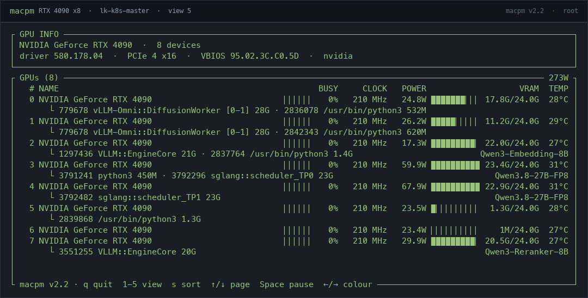
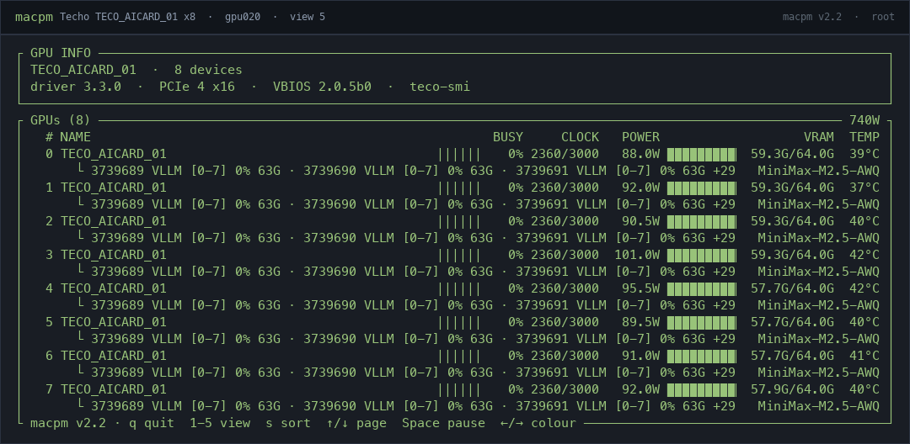

# macpm

**Performance monitoring CLI for Apple Silicon — and now Linux.**<br>
On macOS, macpm reads the same hardware counters as `powermetrics`, but through
IOReport/IOKit/SMC — no `sudo`, no password, no privileged helper.  On Linux it
reads `/proc`, `/sys` and (optionally) RAPL, and tells you exactly which
readings need root.

A Python-based `nvtop`-inspired terminal monitor for Apple Silicon Macs,
forked from [asitop](https://github.com/tlkh/asitop), with an x86_64/arm64
Linux backend.

## What's new in 3.0

- **Runs on Linux** (x86_64/arm64/LoongArch64) from the same package: `/proc`
  and `/sys` sampling, root-aware capabilities, and `n/a` instead of fake
  zeros.  See [Linux support](#linux-support).
- **GPU view built for servers** (key `5`): one table, two lines per card, a
  GPU INFO box, 10-cell VRAM bars, pagination and the served model name.
  Verified on 16× Iluvatar BI-V150S, 64× Denglin KS58, 8× Techo
  TECO_AICARD_01 and 8× RTX 4090.
- **Vendor and NVIDIA backends**: `ixsmi`, `dlsmi`, `teco-smi` and
  `nvidia-smi`, including per-card compute processes and model names.

## Demo

Default view — CPU/GPU/ANE utilisation and power, memory, temperatures/fans,
disk I/O and network, updating once per second:


Same view in another colour theme (press ← / → to cycle through them):


Per-core view (`--show_cores`, or press `2` while running):


Process view (press `3` while running):


Network view (press `4` while running):


## Highlights

- **No sudo required.** `macpm` runs as a normal user process.
- CPU E/P core utilisation and frequency, plus an optional per-core view
- GPU utilisation and frequency
- CPU / GPU / ANE power, rolling average, peaks and throttle state
- RAM and swap usage
- CPU/GPU temperature, peak and fan-load panel (SMC, read-only, no root)
- Disk IOPS/throughput and network throughput
- Process view (`3`) with per-process CPU, memory and GPU usage, sortable with `s`
- Network view (`4`) with TCP state counts, listening ports, per-process traffic
  and the local/public IP, gateway and city
- GPU view (`5`) with utilisation, clock, power, VRAM, temperature and the
  processes using the GPU, ranked by GPU time
- Key-hint footer in every view; the default view also fills the terminal and
  shows the network identity in the processor box when there is room
- Familiar terminal layout, colours, charts and key bindings from macpm 0.x

## Install

Requirements: **Apple Silicon Mac** with **macOS 12+**, or **Linux**
(x86_64/arm64) with `/proc`, `/sys` and **Python 3.9+**.  On Linux the optional
pieces are `ss` (iproute2) for the per-process network table and root for CPU
power / GPU / other users' processes.

```sh
python3 -m pip install --upgrade macpm
```

Then run:

```sh
macpm
```

There is **no `sudo macpm`** since 2.0. Running it with `sudo` still works, but it
is unnecessary and no longer recommended.

Prefer a standalone binary with no Python installation? See
[Standalone binaries](#standalone-binaries).

## Usage

```text
macpm [--interval INTERVAL] [--color COLOR] [--avg AVG] [--show_cores [BOOL]] [--no-public-ip] [--version]
```

| Option | Meaning |
|---|---|
| `--interval SECONDS` | Sampling and display interval (default `1`) |
| `--color 1-8` | Display colour (default `2`) |
| `--avg SECONDS` | Averaging window for power values (default `30`) |
| `--show_cores [BOOL]` | Start in the per-core view |
| `--no-public-ip` | Do not look up the public IP and location |
| `--version` | Print the version |

The default view also has a footer with the key hints.  Keys:

```text
q / ESC         quit
← / →           change colour
1 / 2 / 3 / 4 / 5  default / per-core / process / network / GPU view
s               cycle the sort column (process / network / GPU view)
↑ / ↓           scroll the list or the focused network pane
Space           pause / resume the list (process / network / GPU view)
Tab             switch the focused network pane
Ctrl+R          reset peaks
```

## Colour themes

Pick one with `--color N`, or press ← / → while macpm is running.  The default
is `2` (green).

| | |
|---|---|
| **1 — red**<br> | **2 — green (default)**<br> |
| **3 — yellow**<br> | **4 — blue**<br> |
| **5 — magenta**<br> | **6 — cyan**<br> |
| **7 — white**<br> | **8 — grey**<br> |

## Why no sudo?

macpm 0.x called `sudo powermetrics`. In 2.0 the sampler reads the underlying
counters directly.  The data is not secret; the old `powermetrics` CLI simply
requires root and Apple's private entitlements.

| Metric | Source |
|---|---|
| CPU E/P load and frequency | IOReport `CPU Stats` performance states |
| Per-core load | IOReport `CPU Core Performance States` |
| GPU load and frequency | IOReport `GPU Stats` / `GPU Performance States` |
| CPU / GPU / ANE power | IOReport `Energy Model` |
| RAM / swap | `psutil` |
| Disk / network throughput | `psutil` counters |
| Sockets, listeners, per-process traffic | `nettop` |
| Local IP / prefix / gateway | `psutil`, `route -n get default` |
| Public IP / city | `ipinfo.io` (fallback `ipwho.is`) |
| Per-process CPU / memory | `psutil`, plus `/bin/ps` for other users |
| Per-process GPU | `IOAccelerator` user clients in the IORegistry |
| CPU/GPU temperature, fan RPM | `AppleSMC` via the IOKit user client |
| Thermal throttle | `pmset -g therm` |
| SoC name / core counts | `sysctl` |
| GPU core count | `ioreg` `gpu-core-count` |

The DVFS frequency tables are parsed from the `pmgr` IORegistry node;
M1–M3 store Hz there, M4+ store kHz.

## Temperatures and fans

The default view has a **Temps & Fans** box next to the memory gauge.  It shows
the hottest CPU and GPU sensor with their peaks since the last reset (CPU on
one row, GPU on the next), the current RPM of every fan, and a fan-load bar
for each fan (current speed as a
percentage of its maximum RPM, without a numeric percentage so the bars can
use the full panel width):

```text
┌ Temps & Fans ────────────────────────────────┐
│ CPU 52.4°C   peak 61.5°C                     │
│ GPU 43.1°C   peak 50.0°C                     │
│ Fan 1 2318 rpm  Fan 2 2502 rpm               │
│ F1 ▉▉▉▉▉▉▉▉▉▉▉▉  F2 ▉▉▉▉▉▉▉▉▉▉▉▉▉            │
└──────────────────────────────────────────────┘
```

The values come from `AppleSMC` through the IOKit user client (read-only, no
root).  SMC key names differ between chip generations, so the CPU/GPU sensor
groups are selected per chip family and a missing key is simply shown as `--`.
Fan **control** requires root and is not implemented.

## Process view

Press `3` for a two-box layout.  The top box is titled with the
SoC and core counts (as in views 1/2) and keeps the top-style CPU (E/P
percentages and frequencies), GPU (%, MHz), RAM/swap and
wired/active/inactive/free memory summary.  The second box is the
process table with `PID`, `NAME`, `USER`, `CPU%`, `MEM` and `GPU%`; there is no
power column.  The list is sorted by CPU usage by default; press `s` to cycle
through CPU → MEM → GPU → PID → NAME → USER, and `↑` / `↓` to scroll.  The
header shows the current sort column and direction.  Press `Space` to pause the
list while you scroll through it; the footer changes to `Space resume` and the
summary keeps updating.  The process table refreshes every 2 seconds (or
`--interval`, if larger) to keep macpm's own CPU usage low; the summary above
it refreshes every interval.  macpm's own process is listed as `macpm`.

Per-process CPU and memory come from `psutil`, with `/bin/ps` for processes
owned by other users (so system processes such as WindowServer appear too).
GPU usage is the GPU time of the process' `IOAccelerator` user clients;
processes without a readable GPU client show `0.0`.

## Network view

Press `4` for a network overview built from `nettop`.  The summary box shows
the TCP socket count per state (`ESTABLISHED`, `LISTEN`, `CLOSE_WAIT`,
`TIME_WAIT`), the UDP socket count and the current interface throughput.  Below
it the traffic table lists the busiest processes with their socket count and
per-process download/upload rate, and the listening table lists every TCP
listening socket with its bind address, PID and process.  The traffic table is
sorted by download rate (`↓/s`) by default.  `Tab` moves the focus between the
two tables, `s` cycles the sort column of the focused table (download, upload,
connections, PID, name), `↑` / `↓` scroll it and `Space` pauses sampling.  The
two tables are shown side by side on terminals at least 110 columns wide and
stacked otherwise; the listening table is hidden when the terminal is narrower
than 60 columns or too short for two panes.

Per-process rates are the difference between the cumulative byte counters that
`nettop` reports; the first sample after entering the view is the baseline.  The
traffic table refreshes every 2 seconds from a per-process snapshot, the
socket/listening data every 5 seconds from a full snapshot.  Both only run
while the view is open.

The network view's summary box has a line with the active IPv4 interface and
prefix, the default gateway, and the public IP with its city.  View 1 shows the
same line in a spare row of the Processor box when there is one; the per-core
view leaves that row empty.  For example:

```text
┌ Network ─────────────────────────────────────────────────────────────────────┐
│ en0 192.168.1.23/24  ·  gw 192.168.1.1  ·  203.0.113.45 Nanning, CN Unicom  │
│ TCP  115  EST   61  LISTEN   27  CLOSE_WAIT   25  TIME_WAIT    1  UDP   70   │
│ ↓    11K/s   ↑   4.0K/s   sockets  185   processes   39                      │
└──────────────────────────────────────────────────────────────────────────────┘
```

The local values come from `psutil` and `route -n get default` and refresh
every 30 seconds while the default or network view is open.  The public values
come from a background HTTPS request to `ipinfo.io`, falling back to
`ipwho.is`; for a Chinese address the carrier abbreviation (Telecom, Unicom,
Mobile) is appended after the country code, e.g. `Shanghai, CN Telecom`.  A successful answer is cached
for 10 minutes and a failed one is retried after a minute.  The lookup starts when a view that shows the line is
first drawn — the default view at startup, or the network view — and it
necessarily reveals your public IP to the service; pass `--no-public-ip` to
disable it.  On a narrow terminal the line is clipped with an ellipsis.  This
lookup is the only network request macpm makes.

`nettop` runs without root and, unlike `lsof -i`, sees sockets owned by other
users, so root daemons such as `launchd` and `mDNSResponder` appear in the
listening table.  Three limitations follow from the data source:

- `nettop` does not report sockets without an owning process (typically
  `TIME_WAIT`), so the total is lower than a raw `netstat -an` count;
  `ESTABLISHED`, `LISTEN` and `CLOSE_WAIT` match.
- Byte counters include loopback traffic, so the sum of per-process rates can
  be higher than the interface total in the summary.
- Process names are truncated to about 15 characters, the same `comm` limit
  shown in the process view.

## GPU view

Press `5` for a GPU overview.  A **GPU INFO** box at the top carries the
vendor's identity — full card name, device count, cards, dies per card, driver,
CUDA, PCIe link and VBIOS — and below it the cards are listed, two lines each:
the metrics line (utilisation bar, clock, power, a 10-cell VRAM usage bar,
temperature) and the processes running on that card
(`PID NAME [cards] GPU% MEM`).  A process holding several cards is
repeated on every card it holds, with its range in brackets (`[8-9]`), so a card
that shows memory usage always shows the process behind it; a card with more
processes than fit shows `… +N`.  `s` orders the processes inside each card
by PID → NAME → MEM, `↑` / `↓` turn a whole page (the footer shows `Page 2/5`),
`Space` pauses.  The served model name sits right-aligned on the process line,
recovered from the launcher's command line (`--served-model-name`, `--model`,
`--model-path`, `--model-id`) by walking up the parent chain; a single-GPU view
shows it as a `MODEL` column.

A single-GPU machine keeps the older layout: card summary on top, process table
below.  Every view's footer starts with the app name and version
(`macpm v3.0 · q quit …`).

```text
┌ GPU INFO ────────────────────────────────────────────────────────────────────────────────┐
│ AMD GPU (amdgpu)  ·  4 devices                                                           │
└──────────────────────────────────────────────────────────────────────────────────────────┘
┌ GPUs (4) ─────────────────────────────────────────────────────────────────────────── 48W ┐
│   # NAME                             BUSY     CLOCK   POWER                   VRAM  TEMP │
│   0 AMD GPU (amdgpu)          ▉▏▏▏▏▏  10%  900/1750   12.0W  ▉▏▏▏▏▏▏▏▏▏  1.0G/8.0G  40°C │
│       └ 111 blender 1.0G                                                                 │
│   1 AMD GPU (amdgpu)          ▉▉▏▏▏▏  35% 1000/1750   12.0W  ▉▉▏▏▏▏▏▏▏▏  2.0G/8.0G  43°C │
│       └ 222 Xorg 2.0G                                                                    │
│   2 AMD GPU (amdgpu)          ▉▉▉▉▏▏  60% 1100/1750   12.0W  ▉▉▉▉▏▏▏▏▏▏  3.0G/8.0G  46°C │
│   3 AMD GPU (amdgpu)          ▉▉▉▉▉▏  85% 1200/1750   12.0W  ▉▉▉▉▉▏▏▏▏▏  4.0G/8.0G  49°C │
└ macpm v3.0 · q quit  1-5 view  s sort  ↑/↓ page  Space pause  ←/→ colour ────────────────┘
```

| Platform | What fills each row |
|---|---|
| macOS | One row: IOReport GPU idle ratio and the Energy Model power; the SMC supplies the temperature.  Memory is unified, so the VRAM cell says `unified`. |
| Linux (amdgpu) | One row per `cardN`: `gpu_busy_percent`, `pp_dpm_sclk`, hwmon power/temperature, `mem_info_vram_*` |
| Linux (i915/xe) | One row per card: `gt_cur_freq_mhz` / `tile0/gt0/freq0`, DRM `fdinfo` engine time, hwmon temperature; VRAM only when the driver exposes `lmem_total_bytes` |
| Linux (NVIDIA) | One row per GPU from a single `nvidia-smi --query-gpu` call: utilisation, SM clock, power, memory, temperature.  Compute processes come from `nvidia-smi --query-compute-apps` (SM% joined from `pmon`).  `nvidia-smi` is found on `PATH`, at `/usr/lib/wsl/lib/nvidia-smi` on WSL, or via `MACPM_NVIDIA_SMI` |
| Linux (Iluvatar / 天数) | One row per GPU from `ixsmi --query-gpu` (the vendor's nvidia-smi clone): utilisation, clock, power, HBM, temperature.  `ixsmi` is looked up on `PATH` and in `/usr/local/corex-*/bin`; override with `MACPM_IXSMI=/path/to/ixsmi` |
| Linux (Denglin / 登临) | One row per GPU from `dlsmi --query-gpu` (NVML-compatible): utilisation, clock, power, memory, temperature.  Found on `PATH` or `/usr/bin/dlsmi`; override with `MACPM_DLSMI=/path/to/dlsmi` |
| Linux (Techo / 太初) | One row per device from `teco-smi --query-device` (its own property names: `utilization.spe`, `power.chip`, `clocks.spe`…).  Found on `PATH`, `/opt/tecoai/bin/teco-smi` or via `MACPM_TECO=/path/to/teco-smi` |
| Other drivers | The card is still listed (so you can see that 8 accelerators exist) and probed for `gpu_busy_percent` / `busy_percent` / `utilization` / `load`, `devfreq/*/cur_freq`, `mem_info_*` and hwmon — whatever is missing shows `n/a` |

Linux, from the field — an 8×RTX 4090 node and an 8×Techo node where each
`teco-smi` device reports the same workers:

| RTX 4090 | Techo TECO_AICARD_01 |
|---|---|
|  |  |

Notes:

- Enumeration covers every `/sys/class/drm/cardN` plus every NVIDIA GPU; cards
  with no readable driver are listed with `n/a` rather than hidden.
- Cards and dies per card are derived from serials only when the vendor groups
  devices per board: `ixsmi` shows 16 devices as 8 cards × 2 dies, `dlsmi` 64 as
  8 cards × 8 dies.  `teco-smi` reports 8 cards of four SDAA dies each but does
  not expose that grouping, so the INFO box shows only the device count.
- Model names come from the process tree, never from the model directory: the
  worker is two hops below `vllm serve`/`sglang.launch_server`, and reading
  `config.json` through `/proc/<pid>/root` can block on a stalled network mount.
  Unknown servers show no name rather than a guess.
- The nested process line comes from the vendor's own compute-process list
  (`ixsmi pmon`/`--query-compute-apps`, `dlsmi --query-compute-apps`,
  `teco-smi pmon`) or, on macOS and DRM GPUs, from `fdinfo`/IOAccelerator.  A
  tool that reports no SM percentage makes the `GPU%` cell a dash, and a card
  with more processes than fit shows `… +N`.
- Processes are merged per PID: one row, with the set of cards it holds.  Card
  numbers are compressed (`0-7`, `8-23`).
- The INFO box shows what the vendor tool reports: `ixsmi` gives driver and CUDA
  versions, `dlsmi` and `teco-smi` only the driver, and `nvidia-smi` gives all of
  them.  Drivers that reject a field (580 refuses `cuda_version`) make the query
  fall back to the remaining fields; the PCIe cell uses the link maximum so an
  idle card does not read as generation 1.  Consumer cards report `[N/A]` for
  the serial, so their card/die counts are left out instead of guessed; PCIe
  and VBIOS are hidden when the tool reports `N/A`.
- Intel `fdinfo` counters are machine-wide rather than per card; with more than
  one Intel GPU the per-card BUSY cell shows `n/a` instead of duplicating the
  aggregate on every row.
- The default view's GPU gauge shows the busiest card and appends `(max of N)`
  when the machine has more than one.

## Compatibility

Tested on macOS 27.2 with an M3 Max.  Behaviour depends more on the chip
generation than on the macOS version:

| Environment | Status |
|---|---|
| macOS 12–15, M1–M4 | Works |
| macOS 26, M1–M4 | Likely works |
| macOS 26, M5 / M5 Pro / Max | Partial: new CPU tier/channel names (`MCPU`/`SCPU`) and `acc-clusters` DVFS data are not fully handled |
| macOS 15/26, M1/M2 Ultra | Needs verification: multi-die complex channels may be `ECPU0/1` |
| macOS 27 | Works on the tested M3 Max; some 27 builds restrict unprivileged `Energy Model` refreshes |
| Intel Macs | Not supported; the Apple-Silicon IOReport groups are absent |
| Linux x86_64 / arm64 / LoongArch64 | Supported; verified on 8×RTX 4090 (driver 580) and on Iluvatar/Denglin/Techo servers; see [Linux support](#linux-support) |

## Linux support

macpm runs on x86_64, arm64 and LoongArch64 Linux with the same four views and
key bindings.  The backend is chosen at runtime (`macpm.backend`), so the same
package serves both systems.  Verified on 8×RTX 4090 (driver 580), 16×Iluvatar
BI-V150S, 64×Denglin KS58 and 8×Techo TECO_AICARD_01.

### Run it

```sh
python3 -m pip install macpm
macpm                 # normal user: CPU/RAM/disk/network/processes/temps
sudo macpm            # root: adds CPU power, GPU utilisation and all processes
```

Root is *recommended, not required*.  Readings that need it are shown as `n/a`
instead of a misleading zero, and `macpm-dump --capabilities` prints exactly
what your kernel and permission level expose, and `python3 -m macpm.probe`
inventories the machine without needing psutil or a terminal (handy on compute
nodes):

```sh
macpm-dump --capabilities
python3 -m macpm.probe
```

### What works

| Feature | Linux source | Without root | With root |
|---|---|---|---|
| CPU utilisation, per-core view, E/P split | `/proc/stat`, `topology/core_type`, `cpu_capacity` | ✅ | ✅ |
| CPU frequency | `cpufreq/scaling_cur_freq`, `stats/time_in_state` | ✅ | ✅ |
| CPU power | RAPL `energy_uj` | ❌ n/a | ✅ |
| GPU utilisation | amdgpu `gpu_busy_percent`, i915/xe DRM `fdinfo`, `nvidia-smi` | ✅ (see below) | ✅ |
| GPU frequency / power | `gt_cur_freq_mhz`, `pp_dpm_sclk`, hwmon | ✅ | ✅ |
| Temperatures / fans | hwmon (`coretemp`, `k10temp`, `amdgpu`, `macsmc`…) | ✅ | ✅ |
| Memory / swap | `psutil`, `/proc/meminfo` | ✅ | ✅ |
| Disk I/O, network rate | `/proc/diskstats`, `/proc/net/dev` | ✅ | ✅ |
| Processes CPU/MEM | `/proc/<pid>` via `psutil` | ✅ all users | ✅ |
| Per-process GPU% | DRM `fdinfo` `drm-engine-*` | own processes only | ✅ all |
| TCP/UDP counts, listeners | `/proc/net/{tcp,tcp6,udp,udp6}` | ✅ counts, own PIDs | ✅ all PIDs |
| Per-process traffic | `ss -tanie` `tcp_info` | own processes, TCP only | ✅ all |

**GPU notes.**  `amdgpu` exposes everything.  Intel `i915`/`xe` have no global
busy counter, so macpm sums every DRM client's engine time from `fdinfo` —
which needs root to see other processes, otherwise it only shows macpm's own
GPU work.  NVIDIA uses `nvidia-smi`.  Vendor ARM GPUs and Apple GPU under
Asahi have no exported counters yet and show `n/a`.

**No ANE.**  There is no Linux equivalent of the Apple Neural Engine counter,
so that gauge is removed on Linux.

**Vendor accelerators need a vendor tool.**  Ampere/Intel/AMD GPUs expose
kernel counters, but many accelerator cards only ship a management CLI and no
DRM node at all.  macpm drives them through the vendor's NVML-style tool:
`ixsmi` for Iluvatar (天数), `dlsmi` for Denglin (登临) and `teco-smi` for
Techo (太初), one row per card, with each tool's own query switch
(`--query-gpu` / `--query-device`) and property names mapped onto the same
fields.  Display adapters (ASPEED BMC, EFI framebuffer) are ignored on
purpose.  Per-process GPU time still needs a driver that reports it (`ixsmi
pmon`); Each tool's compute-process list feeds the process table: `ixsmi pmon` joined
with `--query-compute-apps` (memory), `dlsmi --query-compute-apps` and
`teco-smi pmon`.  One row per PID with the cards it holds (`0-7` for a process
spanning eight devices), its card memory and the vendor's GPU% when the tool
reports one — `ixsmi` and `teco-smi` do, `dlsmi` does not, so that column shows
`—` instead of a fake 0.

**No per-process traffic without `ss`.**  Linux has no per-process byte
counter; macpm derives it from the kernel's `tcp_info` dump (`ss -tanie`),
joined to socket owners by inode.  The traffic table is therefore TCP-only and
omits UDP.  `ss` ships with iproute2 on every desktop distribution.

**Memory panel.**  Linux has no `wired` memory; the process view's detail line
shows `cached` / `buffers` / `slab` / `free` instead.

### Known differences from macOS

- Clusters are detected, not reported: an Intel hybrid or big.LITTLE machine
  gets an E/P split, everything else a single `CPU Usage` gauge.
- Without `time_in_state` (e.g. `intel_pstate`, many ARM cpufreq drivers) the
  average frequency is the mean of `scaling_cur_freq`, not a residency-weighted
  average.
- `thermal_pressure` is approximated from PSI (`/proc/pressure/cpu`) and the
  x86 throttle counters, not from a thermal speed limit.
- Containers and VMs see the host's counters or nothing at all; test on bare
  metal.

### Development knobs

Two environment variables make the Linux backend testable anywhere (including
on a Mac):

```sh
# Replay a captured tree instead of the live /proc and /sys:
MACPM_SYSROOT=/tmp/captured-root macpm-dump --capabilities

# Force the Linux backend (with the captured tree above):
MACPM_SYSROOT=/tmp/captured-root MACPM_PLATFORM=linux macpm
```

`tests/linux_fixtures.py` builds such a tree (hybrid x86, arm64 big.LITTLE and
an empty machine) and the test suite runs the full Linux sampler and the
headless UI against it.

## Standalone binaries

Standalone unsigned/ad-hoc arm64 binary (`macpm`) can be built with
`packaging/build.sh` and attached to a GitHub release.  It bundles Python and
all dependencies, so the target Mac needs no Python installation.

On first launch from a browser download, macOS Gatekeeper may ask you to
right-click → Open, or you can remove the quarantine flag:

```sh
xattr -d com.apple.quarantine ./macpm ./macpm.command
```

See [packaging/README.txt](https://github.com/visualcjy/macpm/blob/main/packaging/README.txt) for details.

## Development

```sh
git clone https://github.com/visualcjy/macpm.git
cd macpm
python3 -m venv .venv
. .venv/bin/activate
python3 -m pip install -e .
python3 -m unittest discover -s tests -v
```

The Linux backend is tested on any platform through a fixture tree; no Linux
machine is needed to run the suite:

```sh
python3 -m unittest discover -s tests -v
```

`tests/linux_fixtures.py` builds the fake `/proc` + `/sys` trees, and
`MACPM_SYSROOT` points the sampler at one so `macpm-dump` can be replayed.

Build source and wheel distributions:

```sh
python3 -m pip install build twine
python3 -m build
python3 -m twine check dist/*
```

Build standalone arm64 binaries (build machine needs Python + PyInstaller +
runtime dependencies; the output has no Python dependency):

```sh
PYTHON=python3 packaging/build.sh
```

Release steps are documented in [RELEASE.md](https://github.com/visualcjy/macpm/blob/main/RELEASE.md).

## Troubleshooting

- **`macpm: command not found`** — add your Python user-base `bin` directory to
  `PATH`, or run `python3 -m macpm`.
- **Power readings freeze or show `n/a` on macOS 27** — some builds restrict
  unprivileged `Energy Model` refreshes.  CPU/GPU usage and frequency still
  work; a counter that never reports is shown as `n/a` instead of `0.00W`.
  Run `macpm-dump` to inspect the raw values.
- **M5/Ultra values look wrong** — CPU tier/channel mapping is not complete;
  see the compatibility table.
- **The Temps & Fans box says `SMC unavailable`** — the AppleSMC user client
  could not be opened on this macOS build; the rest of macpm still works.
- **A temperature shows `--`** — not every SMC key exists on every chip; the
  reader only reports the keys that are present.
- **The network view says `nettop unavailable`** — `/usr/bin/nettop` is
  missing or could not run.  The other views keep working.
- **Linux shows `n/a` for power or GPU** — run as root (or add a udev rule that
  makes `/sys/class/powercap/intel-rapl:*/energy_uj` group-readable).  Run
  `macpm-dump --capabilities` to see which source was found.
- **Linux: no per-process traffic** — install `iproute2` (`ss`) and run as
  root to see other users' sockets.
- **Linux: wrong CPU names or no E/P split** — the kernel does not expose
  `topology/core_type` or `cpu_capacity`; macpm falls back to max-frequency
  grouping and then to a single cluster.
- **The network header has no public IP** — the lookup is disabled with
  `--no-public-ip`, or the machine is offline / the service is blocked.  The
  local IP, prefix and gateway still show.

## Changelog

See [CHANGELOG.md](https://github.com/visualcjy/macpm/blob/main/CHANGELOG.md).  The 2.0 release removes the dependency on
`sudo`, `powermetrics` and temporary files.

## Credits

- [asitop](https://github.com/tlkh/asitop) — original Python TUI this project
  was forked from
- [macmon](https://github.com/vladkens/macmon) and
  [Stats](https://github.com/exelban/stats) — IOReport/SMC reference
  implementations
- The IOReport sample-delta and DVFS-table ideas follow those projects

## License

MIT.  See [LICENSE](https://github.com/visualcjy/macpm/blob/main/LICENSE).
