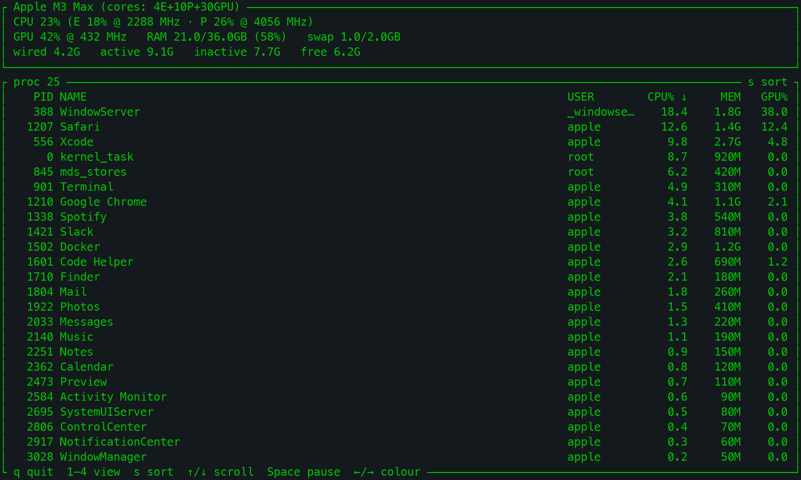
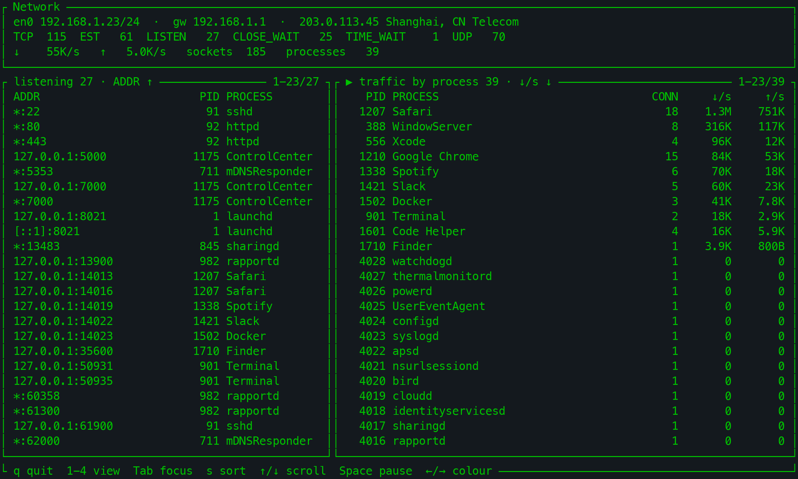

# macpm

**Rootless performance monitoring CLI for Apple Silicon.**<br>
macpm 2.2 reads the same hardware counters as `powermetrics`, but through
IOReport/IOKit/SMC — no `sudo`, no password, no privileged helper.

A Python-based `nvtop`-inspired terminal monitor for Apple Silicon Macs,
forked from [asitop](https://github.com/tlkh/asitop).

## Demo

Default view — CPU/GPU/ANE utilisation and power, memory, temperatures/fans,
disk I/O and network, updating once per second:


Same view in another colour theme (press ← / → to cycle through them):


Per-core view (`--show_cores`, or press `2` while running):


Process view (press `3` while running):



Network view (press `4` while running):



## Highlights

- **No sudo required.** `macpm` runs as a normal user process.
- CPU E/P core utilisation and frequency, plus an optional per-core view
- GPU utilisation and frequency
- CPU / GPU / ANE power, rolling average, peaks and throttle state
- RAM and swap usage
- CPU/GPU temperature, peak and fan-load panel (SMC, read-only, no root)
- Disk IOPS/throughput and network throughput
- Process view (`3`) with per-process CPU, memory and GPU usage, sortable with `s`
- Network view (`4`) with TCP state counts, listening ports, per-process traffic
  and the local/public IP, gateway and city
- Key-hint footer in every view; the default view also fills the terminal and
  shows the network identity in the processor box when there is room
- Familiar terminal layout, colours, charts and key bindings from macpm 0.x

## Install

Requirements: **Apple Silicon Mac**, **macOS 12+**, **Python 3.9+**.

```sh
python3 -m pip install --upgrade macpm
```

Then run:

```sh
macpm
```

There is **no `sudo macpm`** since 2.0. Running it with `sudo` still works, but it
is unnecessary and no longer recommended.

Prefer a standalone binary with no Python installation? See
[Standalone binaries](#standalone-binaries).

## Usage

```text
macpm [--interval INTERVAL] [--color COLOR] [--avg AVG] [--show_cores [BOOL]] [--no-public-ip] [--version]
```

| Option | Meaning |
|---|---|
| `--interval SECONDS` | Sampling and display interval (default `1`) |
| `--color 1-8` | Display colour (default `2`) |
| `--avg SECONDS` | Averaging window for power values (default `30`) |
| `--show_cores [BOOL]` | Start in the per-core view |
| `--no-public-ip` | Do not look up the public IP and location |
| `--version` | Print the version |

The default view also has a footer with the key hints.  Keys:

```text
q / ESC         quit
← / →           change colour
1 / 2 / 3 / 4   default / per-core / process / network view
s               cycle the sort column (process / network view)
↑ / ↓           scroll the list or the focused network pane
Space           pause / resume the list (process / network view)
Tab             switch the focused network pane
Ctrl+R          reset peaks
```

## Colour themes

Pick one with `--color N`, or press ← / → while macpm is running.  The default
is `2` (green).

| | |
|---|---|
| **1 — red**<br> | **2 — green (default)**<br> |
| **3 — yellow**<br> | **4 — blue**<br> |
| **5 — magenta**<br> | **6 — cyan**<br> |
| **7 — white**<br> | **8 — grey**<br> |

## Why no sudo?

macpm 0.x called `sudo powermetrics`. In 2.0 the sampler reads the underlying
counters directly.  The data is not secret; the old `powermetrics` CLI simply
requires root and Apple's private entitlements.

| Metric | Source |
|---|---|
| CPU E/P load and frequency | IOReport `CPU Stats` performance states |
| Per-core load | IOReport `CPU Core Performance States` |
| GPU load and frequency | IOReport `GPU Stats` / `GPU Performance States` |
| CPU / GPU / ANE power | IOReport `Energy Model` |
| RAM / swap | `psutil` |
| Disk / network throughput | `psutil` counters |
| Sockets, listeners, per-process traffic | `nettop` |
| Local IP / prefix / gateway | `psutil`, `route -n get default` |
| Public IP / city | `ipinfo.io` (fallback `ipwho.is`) |
| Per-process CPU / memory | `psutil`, plus `/bin/ps` for other users |
| Per-process GPU | `IOAccelerator` user clients in the IORegistry |
| CPU/GPU temperature, fan RPM | `AppleSMC` via the IOKit user client |
| Thermal throttle | `pmset -g therm` |
| SoC name / core counts | `sysctl` |
| GPU core count | `ioreg` `gpu-core-count` |

The DVFS frequency tables are parsed from the `pmgr` IORegistry node;
M1–M3 store Hz there, M4+ store kHz.

## Temperatures and fans

The default view has a **Temps & Fans** box next to the memory gauge.  It shows
the hottest CPU and GPU sensor with their peaks since the last reset (CPU on
one row, GPU on the next), the current RPM of every fan, and a fan-load bar
for each fan (current speed as a
percentage of its maximum RPM, without a numeric percentage so the bars can
use the full panel width):

```text
┌ Temps & Fans ────────────────────────────────┐
│ CPU 52.4°C   peak 61.5°C                     │
│ GPU 43.1°C   peak 50.0°C                     │
│ Fan 1 2318 rpm  Fan 2 2502 rpm               │
│ F1 ▉▉▉▉▉▉▉▉▉▉▉▉  F2 ▉▉▉▉▉▉▉▉▉▉▉▉▉            │
└──────────────────────────────────────────────┘
```

The values come from `AppleSMC` through the IOKit user client (read-only, no
root).  SMC key names differ between chip generations, so the CPU/GPU sensor
groups are selected per chip family and a missing key is simply shown as `--`.
Fan **control** requires root and is not implemented.

## Process view

Press `3` for a two-box layout.  The top box is titled with the
SoC and core counts (as in views 1/2) and keeps the top-style CPU (E/P
percentages and frequencies), GPU (%, MHz), RAM/swap and
wired/active/inactive/free memory summary.  The second box is the
process table with `PID`, `NAME`, `USER`, `CPU%`, `MEM` and `GPU%`; there is no
power column.  The list is sorted by CPU usage by default; press `s` to cycle
through CPU → MEM → GPU → PID → NAME → USER, and `↑` / `↓` to scroll.  The
header shows the current sort column and direction.  Press `Space` to pause the
list while you scroll through it; the footer changes to `Space resume` and the
summary keeps updating.  The process table refreshes every 2 seconds (or
`--interval`, if larger) to keep macpm's own CPU usage low; the summary above
it refreshes every interval.  macpm's own process is listed as `macpm`.

Per-process CPU and memory come from `psutil`, with `/bin/ps` for processes
owned by other users (so system processes such as WindowServer appear too).
GPU usage is the GPU time of the process' `IOAccelerator` user clients;
processes without a readable GPU client show `0.0`.

## Network view

Press `4` for a network overview built from `nettop`.  The summary box shows
the TCP socket count per state (`ESTABLISHED`, `LISTEN`, `CLOSE_WAIT`,
`TIME_WAIT`), the UDP socket count and the current interface throughput.  Below
it the traffic table lists the busiest processes with their socket count and
per-process download/upload rate, and the listening table lists every TCP
listening socket with its bind address, PID and process.  The traffic table is
sorted by download rate (`↓/s`) by default.  `Tab` moves the focus between the
two tables, `s` cycles the sort column of the focused table (download, upload,
connections, PID, name), `↑` / `↓` scroll it and `Space` pauses sampling.  The
two tables are shown side by side on terminals at least 110 columns wide and
stacked otherwise; the listening table is hidden when the terminal is narrower
than 60 columns or too short for two panes.

Per-process rates are the difference between the cumulative byte counters that
`nettop` reports; the first sample after entering the view is the baseline.  The
traffic table refreshes every 2 seconds from a per-process snapshot, the
socket/listening data every 5 seconds from a full snapshot.  Both only run
while the view is open.

The network view's summary box has a line with the active IPv4 interface and
prefix, the default gateway, and the public IP with its city.  View 1 shows the
same line in a spare row of the Processor box when there is one; the per-core
view leaves that row empty.  For example:

```text
┌ Network ─────────────────────────────────────────────────────────────────────┐
│ en0 192.168.1.23/24  ·  gw 192.168.1.1  ·  203.0.113.45 Nanning, CN Unicom  │
│ TCP  115  EST   61  LISTEN   27  CLOSE_WAIT   25  TIME_WAIT    1  UDP   70   │
│ ↓    11K/s   ↑   4.0K/s   sockets  185   processes   39                      │
└──────────────────────────────────────────────────────────────────────────────┘
```

The local values come from `psutil` and `route -n get default` and refresh
every 30 seconds while the default or network view is open.  The public values
come from a background HTTPS request to `ipinfo.io`, falling back to
`ipwho.is`; for a Chinese address the carrier abbreviation (Telecom, Unicom,
Mobile) is appended after the country code, e.g. `Shanghai, CN Telecom`.  A successful answer is cached
for 10 minutes and a failed one is retried after a minute.  The lookup starts when a view that shows the line is
first drawn — the default view at startup, or the network view — and it
necessarily reveals your public IP to the service; pass `--no-public-ip` to
disable it.  On a narrow terminal the line is clipped with an ellipsis.  This
lookup is the only network request macpm makes.

`nettop` runs without root and, unlike `lsof -i`, sees sockets owned by other
users, so root daemons such as `launchd` and `mDNSResponder` appear in the
listening table.  Three limitations follow from the data source:

- `nettop` does not report sockets without an owning process (typically
  `TIME_WAIT`), so the total is lower than a raw `netstat -an` count;
  `ESTABLISHED`, `LISTEN` and `CLOSE_WAIT` match.
- Byte counters include loopback traffic, so the sum of per-process rates can
  be higher than the interface total in the summary.
- Process names are truncated to about 15 characters, the same `comm` limit
  shown in the process view.

## Compatibility

Tested on macOS 27.2 with an M3 Max.  Behaviour depends more on the chip
generation than on the macOS version:

| Environment | Status |
|---|---|
| macOS 12–15, M1–M4 | Works |
| macOS 26, M1–M4 | Likely works |
| macOS 26, M5 / M5 Pro / Max | Partial: new CPU tier/channel names (`MCPU`/`SCPU`) and `acc-clusters` DVFS data are not fully handled |
| macOS 15/26, M1/M2 Ultra | Needs verification: multi-die complex channels may be `ECPU0/1` |
| macOS 27 | Works on the tested M3 Max; some 27 builds restrict unprivileged `Energy Model` refreshes |
| Intel Macs | Not supported; the Apple-Silicon IOReport groups are absent |

## Standalone binaries

Standalone unsigned/ad-hoc arm64 binary (`macpm`) can be built with
`packaging/build.sh` and attached to a GitHub release.  It bundles Python and
all dependencies, so the target Mac needs no Python installation.

On first launch from a browser download, macOS Gatekeeper may ask you to
right-click → Open, or you can remove the quarantine flag:

```sh
xattr -d com.apple.quarantine ./macpm ./macpm.command
```

See [packaging/README.txt](https://github.com/visualcjy/macpm/blob/main/packaging/README.txt) for details.

## Development

```sh
git clone https://github.com/visualcjy/macpm.git
cd macpm
python3 -m venv .venv
. .venv/bin/activate
python3 -m pip install -e .
python3 -m unittest discover -s tests -v
```

Build source and wheel distributions:

```sh
python3 -m pip install build twine
python3 -m build
python3 -m twine check dist/*
```

Build standalone arm64 binaries (build machine needs Python + PyInstaller +
runtime dependencies; the output has no Python dependency):

```sh
PYTHON=python3 packaging/build.sh
```

Release steps are documented in [RELEASE.md](https://github.com/visualcjy/macpm/blob/main/RELEASE.md).

## Troubleshooting

- **`macpm: command not found`** — add your Python user-base `bin` directory to
  `PATH`, or run `python3 -m macpm`.
- **Power readings freeze or show `n/a` on macOS 27** — some builds restrict
  unprivileged `Energy Model` refreshes.  CPU/GPU usage and frequency still
  work; a counter that never reports is shown as `n/a` instead of `0.00W`.
  Run `macpm-dump` to inspect the raw values.
- **M5/Ultra values look wrong** — CPU tier/channel mapping is not complete;
  see the compatibility table.
- **The Temps & Fans box says `SMC unavailable`** — the AppleSMC user client
  could not be opened on this macOS build; the rest of macpm still works.
- **A temperature shows `--`** — not every SMC key exists on every chip; the
  reader only reports the keys that are present.
- **The network view says `nettop unavailable`** — `/usr/bin/nettop` is
  missing or could not run.  The other views keep working.
- **The network header has no public IP** — the lookup is disabled with
  `--no-public-ip`, or the machine is offline / the service is blocked.  The
  local IP, prefix and gateway still show.

## Changelog

See [CHANGELOG.md](https://github.com/visualcjy/macpm/blob/main/CHANGELOG.md).  The 2.0 release removes the dependency on
`sudo`, `powermetrics` and temporary files.

## Credits

- [asitop](https://github.com/tlkh/asitop) — original Python TUI this project
  was forked from
- [macmon](https://github.com/vladkens/macmon) and
  [Stats](https://github.com/exelban/stats) — IOReport/SMC reference
  implementations
- The IOReport sample-delta and DVFS-table ideas follow those projects

## License

MIT.  See [LICENSE](https://github.com/visualcjy/macpm/blob/main/LICENSE).
