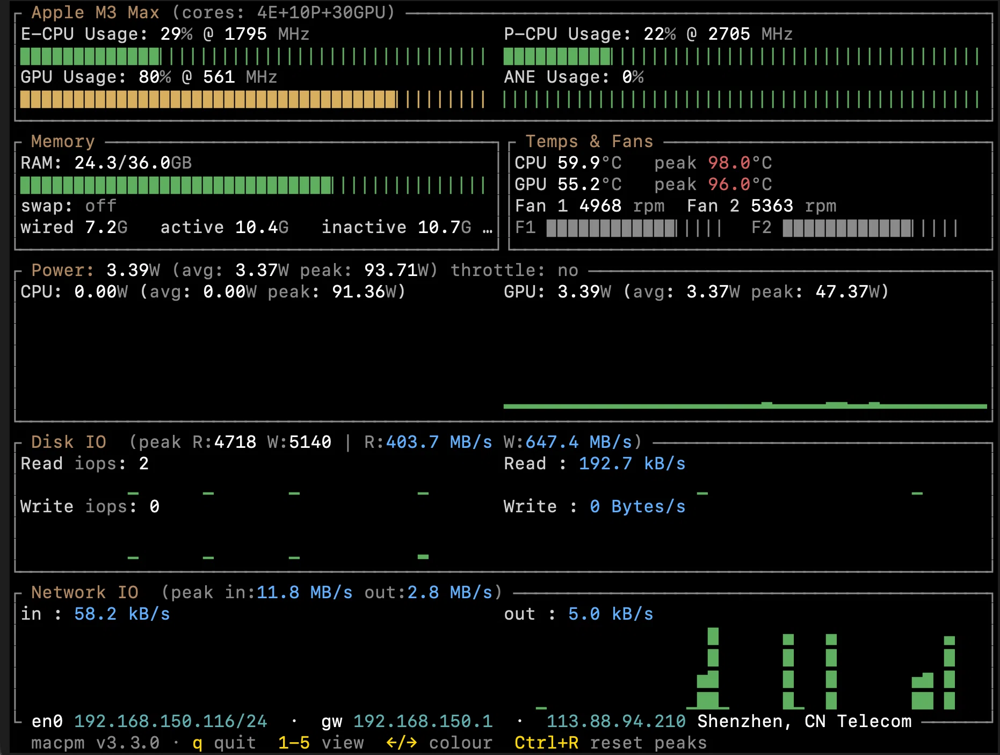
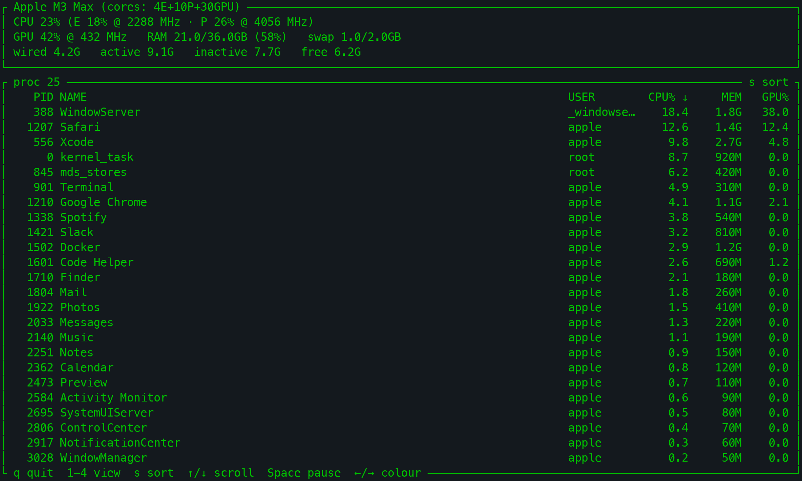
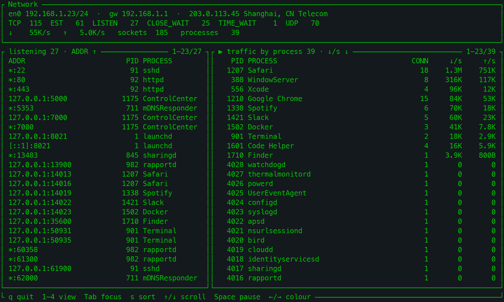

# macpm

[English](README.md) · [简体中文](README.zh-CN.md)

**Apple Silicon 与 Linux 的性能监控 CLI。**<br>
在 macOS 上，macpm 通过 IOReport/IOKit/SMC 读取与 `powermetrics` 相同的硬件计数器——
不需要 `sudo`、不弹密码、不安装特权助手。在 Linux 上读取 `/proc`、`/sys`（以及可选的
RAPL），并明确告诉你哪些读数需要 root。

一个 Python 编写的、受 `nvtop` 启发的 Apple Silicon 终端监控工具，
fork 自 [asitop](https://github.com/tlkh/asitop)，并附带 x86_64/arm64 的 Linux 后端。

## 3.4 新增

- **模型视图（按键 `6`）**：支持 vLLM、SGLang、llama.cpp、ollama、oMLX、Splash。
  服务发现来自进程表、GPU 表与容器端口映射；只轮询当前选中的服务；有日志时
  从服务自己的日志读取逐请求数据。详见[模型视图](#模型视图)。
- **多卡数据不再是假的**：8 卡机器上，GPU 卡片与列表按"该服务实际占用的卡"聚合，
  卡名统一简写（`NV RTX 4090`）。
- **容器日志**：支持 `docker logs` 命令、kubelet 落盘日志、Kubernetes API，
  或容器的 json 日志文件——GPU 节点上不需要装 kubectl。

## 3.3 新增

- **内置语义配色**：第 9 个 `←`/`→` 配色档位（`--native`）按"角色"上色——灰色边框、
  亮白标题与数字、棕色分类框名、近白字段名、暗色次要文本、蓝色 IO 速率、青色 IP、
  绿色正常条形，只有警告/严重才用黄/红。配色使用固定的 xterm-256 索引，不依赖终端主题。
- **表格更易读**：进程、网络、单卡 GPU 表格中只有表头与当前排序列保持高亮。
- **`--no-color` 仍是纯单色**，位于配色环之外。



## 3.0 新增

- **支持 Linux**（x86_64/arm64/LoongArch64）：`/proc` 与 `/sys` 采样、按 root 能力分级，
  读不到就显示 `n/a` 而不是假的 0。详见 [Linux 支持](#linux-支持)。
- **面向服务器的 GPU 视图**（按键 `5`）：单表格、每卡两行、GPU INFO 信息框、
  10 格 VRAM 条、分页、以及所服务的模型名。已在 16× Iluvatar BI-V150S、
  64× 登临 KS58、8× 天数 TECO_AICARD_01、8× RTX 4090 上验证。

## 演示

默认视图——CPU/GPU/ANE 利用率与功耗、内存、温度/风扇、磁盘 IO、网络，每秒刷新：


内置语义配色（`--native`，第 9 个档位）：


同一视图的其他配色（运行时按 ← / → 切换）：


每核视图（`--show_cores`，或运行时按 `2`）：


进程视图（按 `3`）：



网络视图（按 `4`）：



## 亮点

- **不需要 sudo**：以普通用户进程运行。
- CPU 的 E/P 核利用率与频率，以及可选的每核视图。
- GPU 利用率与频率。
- CPU / GPU 功耗、ANE 利用率与（硬件上报时的）ANE 功耗、滚动平均、峰值与降频状态。
- 内存与交换区占用。
- CPU/GPU 温度、峰值与风扇负载面板（SMC，只读，无需 root）。
- 磁盘 IOPS/吞吐与网络吞吐。
- 进程视图（`3`）：逐进程 CPU、内存、GPU 占用，按 `s` 排序。
- 网络视图（`4`）：TCP 状态统计、监听端口、逐进程流量、本机/公网 IP、网关与城市。
- GPU 视图（`5`）：利用率、频率、功耗、显存、温度与占用 GPU 的进程，按 GPU 时间排序；
  AMD/Intel 卡还会显示每个进程的 VRAM/GTT 以及它占用的卡。
- 模型视图（`6`）：本机推理服务的模型名、decode/prefill 速率、KV 与上下文使用、
  首 token 时延、最近请求，以及该服务占用的卡。
- 每个视图都有按键提示底栏；默认视图把网络身份放在 Network IO 框的下边框。

## 安装

要求：**Apple Silicon Mac + macOS 12+**，或 **Linux**（x86_64/arm64，需要
`/proc`、`/sys` 与 **Python 3.9+**）。Linux 上可选依赖：`ss`（iproute2，用于逐进程网络表），
以及 root（用于 CPU 功耗、GPU、读取其他用户的进程）。

```sh
python3 -m pip install --upgrade macpm
```

然后运行：

```sh
macpm
```

自 2.0 起**不需要 `sudo macpm`**。用 sudo 运行仍可用，但没有必要，也不推荐。

想要不装 Python 的独立二进制？见[独立二进制](#独立二进制)。

## 用法

```text
macpm [--interval INTERVAL] [--color COLOR] [--avg AVG] [--show_cores [BOOL]]
      [--no-public-ip] [--model-url URL] [--version]
```

| 选项 | 含义 |
|---|---|
| `--interval SECONDS` | 采样与刷新间隔（默认 `1`） |
| `--color 1-8` | 配色（默认 `2`） |
| `--native` | 以内置语义配色启动 |
| `--no-color` | 不输出颜色，使用终端默认前景色 |
| `--avg SECONDS` | 功耗的滑动平均窗口（默认 `30`） |
| `--show_cores [BOOL]` | 直接进入每核视图 |
| `--no-public-ip` | 不查询公网 IP 与位置 |
| `--model-url URL` | 为模型视图额外添加一个端点（可重复） |
| `--version` | 打印版本 |

按键：

```text
q / ESC        退出
← / →          切换配色
1 / 2 / 3 / 4 / 5 / 6   默认 / 每核 / 进程 / 网络 / GPU / 模型视图
s              切换排序列（进程 / 网络 / GPU 视图）
↑ / ↓          滚动列表或网络面板
Space          暂停 / 恢复列表刷新
Tab            切换网络面板焦点
Ctrl+R         重置峰值
```

## 配色

用 `--color N` 选择，或运行时按 ← / →。默认是 `2`（绿）。配色环共 9 档：`1`–`8`
用单一 ANSI 强调色，第 9 档（`--native`）使用语义配色：边框灰、标题与数字亮白、
分类框名棕色、字段名近白、普通文本暗、IO 速率蓝、IP 青色、正常条形绿、底栏按键提示黄，
只有警告/严重才用黄/红。`--no-color` 输出纯文本，适合配合终端主题与关键字高亮。

## 为什么不需要 sudo

macpm 用与 `powermetrics` 相同的只读接口（IOReport、IOKit、SMC），但以普通用户读取，
不写临时文件、不装特权助手。老版本依赖 `sudo powermetrics`，2.0 起已移除。

## 温度与风扇

温度来自 SMC 的只读键（CPU/GPU 各若干），风扇显示当前转速与负载百分比。某些机型/系统
版本上部分键不存在，对应位置显示 `--`；`SMC unavailable` 表示客户端打不开，其他功能不受影响。

## 进程视图

按 `3`。逐进程显示 CPU%、内存、GPU%（可用时）与进程身份；`s` 循环切换排序列，
↑/↓ 滚动，Space 暂停。Linux 上 GPU 侧需要能读 `fdinfo`（同用户或 root）。

## 网络视图

按 `4`。上半部分是接口、CIDR、网关、公网 IP 与城市；下面是 TCP 状态统计、监听端口
与逐进程流量（Linux 上需要 `ss`，其他用户的连接需要 root）。多网卡时 Tab 切换焦点面板。

## GPU 视图

按 `5`。顶部 GPU INFO 框给出卡型、数量、驱动、PCIe 代宽、VBIOS 与厂商；下面是每卡
两行：型号/利用率/频率/功耗/显存/温度/内存占用/性能状态，第二行列出占用 GPU 的进程
（Linux 上还会显示各进程显存），并按 GPU 时间排序。超过一屏时用 ↑/↓ 翻页。

## 模型视图

按 `6` 进入。它回答三个问题：这台机器在服务哪些模型、它们占用哪些卡、此刻有多快——
并且在你选中之前不会向任何服务发请求。

**发现阶段不依赖 HTTP**，服务来自三个来源：

| 来源 | 提供什么 |
|---|---|
| 进程表 | 启动命令行（`vllm serve …`、`sglang.launch_server …`、`llama-server`、`ollama serve`、oMLX、Splash）及其 `--port` |
| GPU 表 | 持卡 PID 占用的卡与显存，以及所服务的模型名 |
| 容器端口映射 | `docker ps` 的发布端口，镜像名能识别出后端时使用 |

候选按**网络命名空间**归组：一个 launcher 与它的 TP worker 属于同一个服务；同一模型跑在
不同卡上则是两行。随后在该命名空间内解析端口（`/proc/<pid>/net/tcp`，以 root 运行时
可深入容器），并用 `GET /v1/models` 确认——**模型名与后端取自该响应的 `id` 与 `owned_by`**，
不做猜测。

**轮询策略**：只轮询选中的服务（每秒一次）；其余每 5 秒做一次轻量 `/v1/models` 探测，
让 `STATE` 列有意义。不会向服务写入任何内容。

**各后端能力**：

| 后端 | 能读到什么 | 相关变量 |
|---|---|---|
| Splash | `/status`，以及 `~/Library/Logs/Splash/server.log` 的逐请求行（输入/输出/缓存 token、TTFT、tok/s） | `SPLASH_LOG` |
| llama.cpp | `/props`、`/metrics`、`/slots` | — |
| vLLM | `/metrics` 计数器（prefill/decode 速率、running/waiting、KV）；`Engine 000:` 日志行还提供前缀缓存命中率 | — |
| SGLang | 启用时读 `/metrics` 与 `/get_server_info`，否则只有模型名 | — |
| oMLX | `/admin/api/activity`（仅当前请求） | — |
| ollama | `/api/ps`（已加载模型，无吞吐） | — |

服务没开 `/metrics` 时（SGLang 常见）视图仍然有用：模型名、端点、上下文上限与 GPU 卡片
照常显示，note 里写明 `metrics endpoint unavailable`，而不是假装有数据。

**从日志或容器读逐请求数据**（可选，每个后端一组变量，前缀 `SPLASH_`、`VLLM_`、
`SGLANG_`、`OLLAMA_`、`LLAMACPP_`）：

```sh
VLLM_LOG=/var/log/vllm/server.log                     # 本机日志文件
VLLM_LOG_CMD="docker logs --since=10s vllm-qwen"      # 任意命令，重复执行并按行去重
VLLM_DOCKER=vllm-qwen                                 # docker inspect 找到 json 日志
VLLM_POD=deploy-model93                               # 自动定位最新的 /var/log/pods/…/0.log
VLLM_K8S_POD=deploy-model93                           # 走 Kubernetes 日志 API
K8S_APISERVER=https://10.0.0.1:6443 K8S_TOKEN=…       # 配合 token（kubeconfig 亦可）
VLLM_LOG_URL=http://127.0.0.1:8080/admin/api/logs     # 任意文本日志端点
```

**卡片里的数字**：decode/prefill 速率、**所选服务占用的那几张卡**的 GPU 负载 / 显存 /
温度 / 功耗（副标题给出数量，如 `2x NV RTX 4090`）、上下文占用与最近请求列表。
若 PID 无法归属到卡，则回退为全部卡，副标题会显示全卡数量。

**手动端点**：`--model-url host:port` 可补充发现遗漏的服务（可重复），适用于只监听在
其他命名空间里的服务。

## 兼容性

| 机型 | 状态 |
|---|---|
| M1 系列 | 完整支持 |
| M2 / M3 / M4 | 完整支持 |
| M5 / Ultra | CPU 层级映射不完整，功耗读数可能偏差 |

## Linux 支持

### 运行

```sh
python3 -m pip install macpm
macpm
```

### 可用功能

`/proc` 与 `/sys` 提供 CPU 利用率/频率、内存、磁盘与网络；GPU 通过厂商工具或 DRM
（`nvidia-smi`、`rocm-smi`、`fdinfo`）读取；CPU 功耗需要 RAPL。缺少权限时显示 `n/a`
并说明原因。

### 与 macOS 的已知差异

- 没有 ANE/风扇/SMC 温度；
- CPU 功耗依赖 RAPL（root 或 udev 规则）；
- 其他用户的进程与套接字需要 root 才能看到完整信息。

### 开发开关

```sh
# 用抓取的 /proc、/sys 快照回放，而不是真实系统：
MACPM_LINUX_ROOT=/tmp/snapshot macpm --linux

# 强制使用 Linux 后端（配合上面的快照）：
MACPM_BACKEND=linux macpm
```

## 独立二进制

### macOS（arm64）

从 [Releases](https://github.com/visualcjy/macpm/releases) 下载
`macpm-<版本>-macos-arm64.tar.gz`，解压后直接运行 `./macpm`。

### Linux（x86_64 / aarch64）

下载 `macpm-<版本>-linux-x86_64.tar.gz`，或自行构建：

```sh
packaging/build-linux.sh x86_64     # 或 aarch64 / both
```

产物在 `dist/` 下，解压即用，不依赖系统 Python。

## 开发

```sh
git clone https://github.com/visualcjy/macpm.git
cd macpm
python3 -m pip install -e .
python3 -m unittest discover -s tests     # 450+ 用例
```

打包：

```sh
packaging/build.sh                # macOS tarball + wheel
packaging/build-linux.sh x86_64   # Linux tarball
```

## 排错

- **`macpm: command not found`** —— 把 Python 用户级 `bin` 目录加入 `PATH`，或用 `python3 -m macpm`。
- **macOS 27 上功耗冻结或显示 `n/a`** —— 部分系统限制非特权的 Energy Model 刷新，
  CPU/ANE 通道可能停止更新而 GPU 正常。连续 10 个采样无更新的计数器显示 `n/a`
  而不是 `0.00W`，此时 Power 框显示 `Power (GPU only)`。可用 `macpm-dump` 查看原始值。
- **Temps & Fans 显示 `SMC unavailable`** —— 当前系统版本无法打开 AppleSMC 用户客户端，
  其余功能不受影响。
- **某个温度显示 `--`** —— 并非每个芯片都有对应的 SMC 键，读取器只报告存在的键。
- **网络视图显示 `nettop unavailable`** —— `/usr/bin/nettop` 缺失或无法运行，其他视图正常。
- **Linux 显示功耗或 GPU 为 `n/a`** —— 用 root 运行，或添加 udev 规则让
  `/sys/class/powercap/intel-rapl:*/energy_uj` 可读；`macpm-dump --capabilities` 可查看来源。
- **Linux 没有逐进程流量** —— 安装 `iproute2`（`ss`），并以 root 读取其他用户的套接字。
- **模型视图为空** —— 发现需要看到 launcher 进程或 GPU 表。在非 root 的容器节点上，
  用 `sudo -E macpm` 让 `/proc/<pid>/net/tcp` 与 `nvidia-smi` 完整；仍找不到的服务可用
  `--model-url host:port` 手动补充。
- **模型视图端点显示 `?`** —— 该命名空间内端口无法解析（权限不足），或没有 API 应答。
  GPU 数据仍然真实，用 `--model-url` 命名后即可轮询。
- **选中模型显示 `metrics endpoint unavailable`** —— 服务应答了 `/v1/models` 但没有
  `/metrics`（SGLang 常见）。开启后端指标即可获得速率；模型、上下文与 GPU 卡片照常可用。
- **`STATE` 一直是 `unverified`** —— 每 5 秒的 `/v1/models` 探测从本机到不了该 pod IP，
  选中行也会同样无法轮询。

## 更新日志

见 [CHANGELOG.md](https://github.com/visualcjy/macpm/blob/main/CHANGELOG.md)。

## 致谢

- [asitop](https://github.com/tlkh/asitop) —— 本项目的原始 TUI 来源
- [macmon](https://github.com/vladkens/macmon) 与 [Stats](https://github.com/exelban/stats)
  —— IOReport/SMC 参考实现

## 许可

MIT，见 [LICENSE](https://github.com/visualcjy/macpm/blob/main/LICENSE)。
